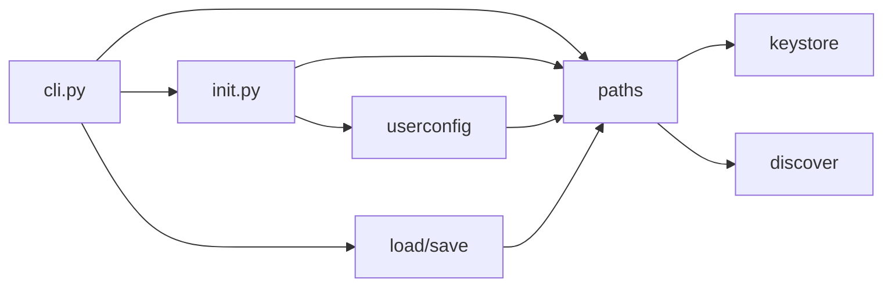

# Architecture Update -- Sprint 008: File location reporting and user public-key config

## What Changed

- New `paths` module: pure functions resolving every dotconfig location (age key file, wrapped/sidecar paths, user config, ssh config, config root and project files) and the source of each (env, default, discovered). Absorbs path logic currently spread over `keystore` and `discover` by delegating (those keep their public API).
- New `userconfig` module: load, validate and seed `config.yaml`; returns `[(key, label)]`.
- `init.py`: new label-aware `_parse_sops_keys` (returns key/label pairs; `_collect_age_keys` remains and delegates), `_render_sops_yaml` accepts labeled keys, `_update_sops_yaml` merges user-config keys.
- `cli.py`: new `where` command; `load`, `save`, `init`, `age`, `key` print resolved paths via `output.py`.

Dependencies are acyclic: `paths` depends only on stdlib plus existing leaf helpers (keystore key-path logic is moved into paths and keystore imports it, to avoid a cycle).

## Why

SUC-001..SUC-004; issues report-file-locations and user-config-public-keys.

## Design Decisions

### D1: sops.yaml layout carrying labels
- **Verified** with installed sops 3.11.0 (temp-file encrypt/decrypt round trip): both a list-valued `age:` with trailing `# label` comments and `key_groups: [{age: [...]}]` with trailing comments encrypt and decrypt correctly, with all recipients present.
- **Decision**: catch-all rule uses `key_groups` with one group, `age:` as a YAML list, one key per line with `  # label` trailing comment. Public.env no-op rule unchanged.
- **Why**: `key_groups` is the long-documented sops form (works on older sops than a list-valued rule-level `age:`, which was only verified on 3.11); a single group keeps "any one key can decrypt" semantics identical to today.
- **Alternatives**: list-valued `age:` (less portable); comment lines above a folded scalar (labels detach from keys, fragile).
- **Parsing**: YAML loaders drop comments, so labels are read with a line scanner (`- age1... # label`) alongside `yaml.safe_load` for keys. `_collect_age_keys` is extended to read `key_groups` as well as block scalar, inline string and list forms. Labels found in the existing file are kept for keys not in the user config; user-config labels win when both exist. Old block-scalar files upgrade to the new layout on next init (keys unlabeled unless user config provides labels).

### D2: Re-encryption after recipient change
- **Decision**: `init` does NOT re-encrypt. If the recipient set changed and the config dir contains SOPS-encrypted files, init prints a clear message: "recipients changed; run `dotconfig reencrypt`".
- **Why**: `reencrypt_all` decrypts and rewrites every file, fails fast partway (partial state), needs the key unlocked, and init may run with a locked or wrapped key. Rewriting secrets as a side effect of a setup command is surprising. Telling the user is safe; the command is idempotent to run.
- **Consequence**: new recipients cannot decrypt until the user runs `reencrypt`; the message says so.

### D3: User config location
`$XDG_CONFIG_HOME/dotconfig/config.yaml` if set and non-empty, else `~/.config/dotconfig/config.yaml`. Created on init only when missing; never overwritten. Seed label `<user>@<hostname>`.

## Impact on Existing Components

`init`, `cli`, `load`, `save`, `keystore`, `discover` touched. Output gets chattier (suppressed by `--quiet`). Existing sops.yaml files are rewritten to the new layout on next `init`.

## Migration Concerns

Old sops.yaml forms remain readable. Rewritten layout is read by sops >= versions supporting key_groups (all supported). No data migration.

## Architecture Self-Review

- Consistency: Sprint changes match body. OK.
- Codebase alignment: `_collect_age_keys` docstring claims list support but code ignores `key_groups`; ticket 003 fixes. Feasible.
- Design quality: `paths` and `userconfig` each have one purpose; no cycles; init fan-out 3. No god component or shared mutable state.
- Risks: label-comment parsing is line-based (mitigated by tests with all legacy forms); partial migration of old files.
- Verdict: **APPROVE WITH CHANGES** (cycle avoidance between paths/keystore must be handled in ticket 001).

## Open Questions

None blocking.
